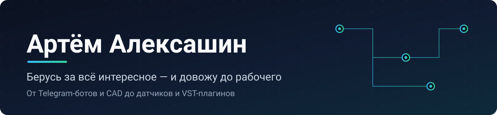
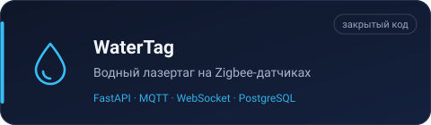
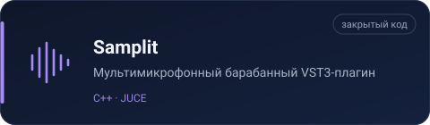
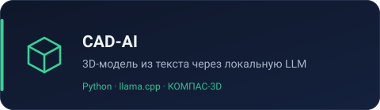
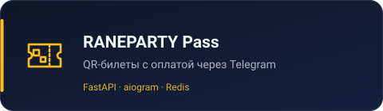
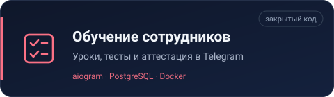
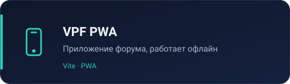
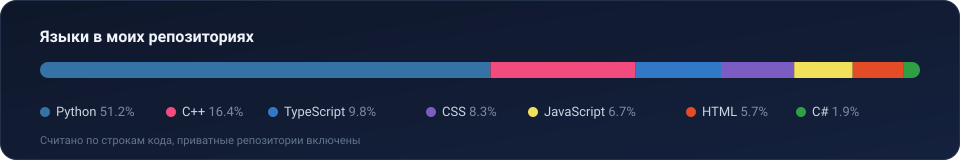

  

  
  

Узкой специализации у меня нет. Беру задачи, в которых надо разобраться, и довожу до рабочего результата.

## Проекты

<table>
  <tr>
    <td width="50%"></td>
    <td width="50%"></td>
  </tr>
  <tr>
    <td width="50%"></td>
    <td width="50%"></td>
  </tr>
  <tr>
    <td width="50%"></td>
    <td width="50%"></td>
  </tr>
</table>

## Стек

Ещё: aiogram, SQLAlchemy, Alembic, MQTT, WebSocket, JUCE, Qt, Mikrotik.

## Языки

## Исследования

Соавтор зарегистрированной программы для ЭВМ (свидетельство № 2025615368), участвовал в научных публикациях и конференциях. Интересуют САПР, прикладной ИИ и алгоритмы оптимизации.

## Активность

<picture>
  <source media="(prefers-color-scheme: dark)" srcset="https://raw.githubusercontent.com/Alexashin/Alexashin/output/github-snake-dark.svg">
  <source media="(prefers-color-scheme: light)" srcset="https://raw.githubusercontent.com/Alexashin/Alexashin/output/github-snake.svg">
  
</picture>
